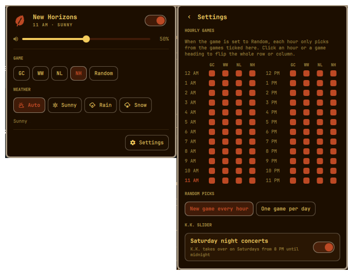

# AC Hourly Music for Omarchy

Animal Crossing's hourly music in your Omarchy bar. A leaf sits in the bar.
Every hour on the hour the music changes, just like in the games. It can
follow your real weather with the rain and snow versions, and K.K. Slider
takes over on Saturday nights.

Nothing is downloaded to your machine; tracks stream on demand.



## Features

- **Four games:** Animal Crossing (GameCube), Wild World / City Folk, New Leaf, New Horizons, or **Random**.
- **Real weather:** *Auto* plays the rain and snow versions when it's raining or snowing where you are. You can also lock it to Sunny, Rain, or Snow.
- **Per-hour picks:** a 24-hour grid in Settings controls which games Random can choose for each hour. Don't like New Leaf's 11 AM theme? Untick it.
- **Random every hour, or one game per day.**
- **K.K. Slider:** Saturday night concerts from 8 PM until midnight, or K.K. all the time. Choose live, aircheck, or both versions.
- **Seamless loops:** songs loop at the game's loop points instead of restarting the intro.
- Fades between tracks, optional notifications, and remembers whether it was playing when you log back in.

## Install

```bash
omarchy plugin add https://github.com/NinDaniel/omarchy-ac-music --enable
```

The plugin needs `mpv` and `curl`, which Omarchy ships by default.

## Using it

| On the leaf  | Does                                         |
|--------------|----------------------------------------------|
| Left click   | Open the panel                               |
| Right click  | Play / pause                                 |
| Middle click | Shuffle to another game (Random) or skip a K.K. song |
| Scroll       | Volume                                       |

Inside the panel, press `p` to play or pause, `n` for next, `s` for Settings, and `Esc` to go back or close.

### Weather location

Auto weather uses the location set in Omarchy's own weather widget. If none is set, it detects your location the same way that widget does. To change it, set a location in the weather widget and the music follows.

### Command line and keybinds

`bin/ac-music` wraps the plugin's IPC:

```bash
ac-music toggle            # play / pause
ac-music next
ac-music game new-leaf     # animal-crossing | wild-world | new-leaf | new-horizons | random
ac-music weather rain      # auto | sunny | rain | snow
ac-music volume +5
ac-music kk                # K.K. all the time on/off
ac-music settings          # open the panel on Settings
ac-music status
```

To put it on your PATH:

```bash
ln -s ~/.config/omarchy/plugins/danr.ac-music/bin/ac-music ~/.local/bin/ac-music
```

Example Hyprland binding in `~/.config/hypr/bindings.lua`:

```lua
o.bind("SUPER + CTRL + M", "AC music play/pause", "ac-music toggle")
```

### Config file

Settings live in `~/.config/omarchy/ac-music.json` and apply live if you edit the file by hand.

## Credits

The music is streamed from the server run by the
[Animal Crossing Music extension](https://github.com/animal-crossing-music-extension/ac-music-extension)
project, the browser extension that inspired this plugin. The loop points and
K.K. song list also come from that project (zlib license). This plugin
requests one track per hour (one per song during K.K.), and it uses
[Open-Meteo](https://open-meteo.com) for weather instead of the extension's
weather API. If the extension's server goes away, this plugin stops working.

Animal Crossing is a trademark of Nintendo. This is an unofficial fan project
and is not affiliated with or endorsed by Nintendo.

## License

MIT; see [LICENSE](LICENSE).
