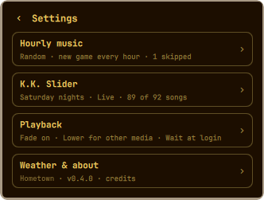
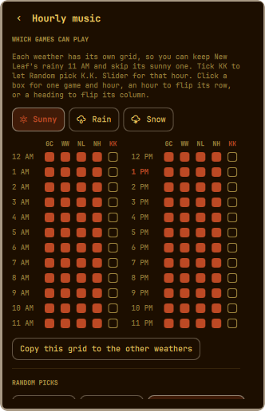
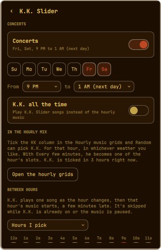
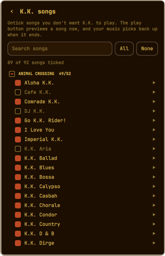
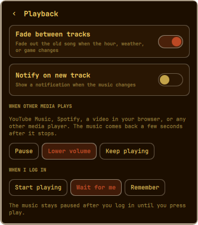
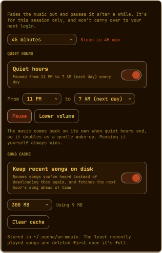
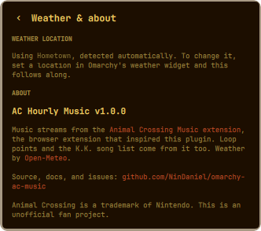

# AC Hourly Music for Omarchy

Animal Crossing's hourly music in your [Omarchy](https://omarchy.org) bar.

A small leaf sits in your bar. Every hour, on the hour, the music changes to
that hour's theme, just like in the games. It can follow your real weather
with the rain and snow versions, mix the four games together, step aside
when you play something else, and bring in K.K. Slider: for concerts on your
own schedule, as part of the hourly mix, or for one song as each hour begins.

There's nothing to download up front: tracks stream as they play, and the ones
you've heard recently are kept in a small cache (300 MB by default) so they
don't download again every day.

> Inspired by, and streaming its music from, the
> [Animal Crossing Music extension](https://github.com/animal-crossing-music-extension/ac-music-extension).
> Full credits are [at the bottom](#credits).


## Contents

- [Features](#features)
- [Install](#install)
- [The bar icon](#the-bar-icon)
- [The panel](#the-panel)
- [Media keys](#media-keys)
- [Settings](#settings)
  - [Hourly music](#hourly-music)
  - [K.K. Slider](#kk-slider)
  - [Playback](#playback)
  - [Weather & about](#weather--about)
- [Command line and keybinds](#command-line-and-keybinds)
- [Config file](#config-file)
- [Updating and uninstalling](#updating-and-uninstalling)
- [Troubleshooting](#troubleshooting)
- [Network and privacy](#network-and-privacy)
- [Development](#development)
- [Ideas for later](#ideas-for-later)
- [Credits](#credits)

## Features

- **Four games:** Animal Crossing (GameCube), Wild World / City Folk, New Leaf, and New Horizons, or **Random** to mix them.
- **Real weather:** on *Auto*, you hear the rain and snow versions when it's raining or snowing where you are. You can also lock it to Sunny, Rain, or Snow.
- **Per-hour, per-weather picks:** grids decide which games Random may choose each hour, with a separate grid for sunny, rainy, and snowy weather. Love New Leaf's rainy 11 AM but not its sunny one? Untick just that box.
- **Three ways to mix:** a new game every hour, one game all day, or switch every few minutes (10, 15, 30, or any interval you like).
- **K.K. Slider, your way:**
  - **Concerts** on the days and hours you choose (Saturday 8 PM to midnight out of the box), or K.K. all the time.
  - **In the hourly mix:** tick K.K. in the grids and Random can pick him for an hour, like a fifth game.
  - **Between hours:** one K.K. song as the hour changes, before that hour's music starts.
  - **Every song, both versions:** tick the live and aircheck version of each of the 92 songs separately, with search and previews.
- **Seamless loops:** each song loops at the game's own loop point instead of restarting its intro.
- **Steps aside for other media:** when YouTube Music, Spotify, a video, or any other player starts, the music pauses or turns down. It comes back by itself when that stops.
- **Your choice at login:** start playing, wait for you to press play, or pick up where you left off.
- **Media keys:** your keyboard's play/pause key, headset buttons, and Omarchy's media controls all work, with the game and hour as the track title.
- **Sleep timer and quiet hours:** fade out after 15 minutes to an hour and a half, or pause (or turn down) the music at the same time every night and bring it back in the morning.
- **Light on data:** recently played songs are kept in a small cache, and the next hour's song is fetched ahead of time, so the hour changes instantly.
- **Fits Omarchy:** uses Omarchy's own panel styling, follows your theme, and works with any bar position.
- **Scriptable:** a small `ac-music` command for terminals and keybinds.

## Install

```bash
omarchy plugin add https://github.com/NinDaniel/omarchy-ac-music --enable
```

The leaf appears on the right side of your bar and the music starts.

**Requirements:** `mpv` and `curl`, plus `mpv-mpris` for [media keys](#media-keys) and
`notify-send` for track notifications. All four come with Omarchy, so there's
nothing extra to install. Without `mpv-mpris` or `notify-send`, everything
else still works.

**Moving the leaf:** drag it along the bar like any other widget, or run:

```bash
omarchy bar move io.github.nindaniel.ac-music --section left    # left | center | right
```

## The bar icon

| On the leaf  | What it does                                                  |
|--------------|---------------------------------------------------------------|
| Hover        | Shows what's playing (and whether it's paused or on hold)     |
| Left click   | Opens the panel                                               |
| Right click  | Play / pause                                                  |
| Middle click | Shuffle to another game (Random), skip to the next K.K. song, or skip a between-hours song |
| Scroll       | Volume up / down in 5% steps                                  |

The leaf is dimmed while the music is paused, on hold, or turned down.

## The panel

<p>
  
  
  
</p>

From top to bottom:

- **Now playing:** the game (or *K.K. Slider*) with the hour and weather underneath, or the song title and version during K.K. The switch on the right plays and pauses. A **Paused** or **On hold** tag shows when the music isn't playing. While K.K. is playing (a concert, a K.K. hour, a between-hours song, or a preview), the leaf here becomes the song's **album cover**. The leaf in your bar never changes.
- **Volume:** the slider sets the plugin's own volume, separate from your system volume.
- **Game:** **GC** (Animal Crossing on GameCube), **WW** (Wild World / City Folk), **NL** (New Leaf), **NH** (New Horizons), or **Random**. Hover a button for the full name. Picking a specific game always plays that game; the per-hour grid only applies to Random.
- **Weather:** **Auto** follows the real weather. **Sunny**, **Rain**, and **Snow** lock it. On Auto, the line underneath shows the current conditions and where they're from.
- **On hold:** when another player is playing, a line explains that the music is paused (or quieter) and will come back on its own.
- **Shuffle game / Next song / Skip to the hour:** shows when it's useful. On Random it rolls a different game for now. During K.K. it skips to another song. During a between-hours song it skips straight to the hour's music.
- **Settings:** opens the settings menu (see below).

**Keyboard**, while the panel is open:

| Key         | Action                                      |
|-------------|---------------------------------------------|
| `p`, Space, or Enter | Play / pause                    |
| `n`         | Same as the Shuffle / Next / Skip button    |
| `s`         | Switch between the panel and Settings       |
| `Esc`       | Go back one page, or close the panel        |
| `Tab`       | Move to the neighbouring bar panel          |

## Media keys

The music shows up in your system's media controls as **AC Music**, with titles
like *New Horizons · 11 AM · Sunny* or *K.K. Bossa · K.K. Slider (Live)*. So:

- Your keyboard's **play/pause** key and headset buttons play and pause it (when it's the active player).
- **Omarchy's media widget** and anything else that shows what's playing can see and control it.
- Pausing it there pauses it everywhere: the panel's switch follows along, and the choice is saved.
- Pressing play while it's on hold for another player plays it anyway.

This uses `mpv-mpris`, which is part of Omarchy's standard install. Without it,
everything else still works and only the media keys don't.

Next/previous track keys don't do anything here. Use the panel's
Shuffle / Next / Skip button (or `ac-music next`) instead.

## Settings

Settings opens on a short menu. Each row shows a summary of what's set inside,
so you can see your whole setup at a glance, and opens its own page. Every page
has a back arrow, and `Esc` goes back one page at a time.

<p>
  
  
</p>

Every change saves immediately; there's no Save button.

### Hourly music

Everything about how **Random** chooses a game. None of it applies when you've
picked a specific game on the main panel. You chose that game, so you hear all
of it, and the page reminds you of that.

#### Which games can play

Three grids, one each for **Sunny**, **Rain**, and **Snow**, picked with the
tabs at the top. The page opens on the tab for the current weather. Each grid
is 24 hours by five columns: the four games (`GC`, `WW`, `NL`, `NH`) and
**`KK`** for K.K. Slider. Random only picks from what's ticked for the current
hour **in the current weather's grid**.

- Click a box to tick or untick one column for one hour.
- Click an **hour** (like `11 AM`) to tick or untick its whole row.
- Click a **column heading** (like `NL`) to tick or untick that column for all twelve hours in that half of the grid (AM or PM).
- The current hour is highlighted.
- An hour with **nothing** ticked behaves as if the four games are ticked, so it never goes silent.
- **Copy this grid to the other weathers** makes the grid you're looking at the grid for all three weathers. It's handy when you want one change everywhere.

So if you love New Leaf's rainy 11 AM but not its sunny one: open the **Sunny**
tab and untick `NL` at `11 AM`, and leave the **Rain** tab alone.

**The `KK` column** starts unticked everywhere. Tick it for an hour and Random
can pick K.K. Slider for that hour, just like a game: he plays songs back to
back (from your [chosen songs](#choose-songs)) until the hour or the pick
changes. Because each weather has its own grid, "K.K. on rainy afternoons" is
just a few ticks on the Rain tab. It works with every Random mode: **Once a day**
can land on a K.K. day, and **Every few minutes** treats him as one of the
hour's slots, for example New Leaf, then fifteen minutes of K.K., then Wild World.

**GameCube on the Rain tab.** The original GameCube game has no rain music, so
on rainy days it plays its sunny theme. Its `GC` column on the Rain tab is
greyed out and simply shows your **Sunny** ticks, which is what decides it.
Untick GameCube's sunny 11 AM and it won't play at 11 AM on rainy days either.
(GameCube does have snow music, so its Snow column works normally.)

#### Random picks

How often Random chooses. The line under the buttons explains the selected option.

| Option                | What you hear |
|-----------------------|---------------|
| **Every hour**        | A new game each hour, chosen from that hour's ticked games. |
| **Once a day**        | One game all day, from midnight to midnight on your computer's clock. If that game is unticked for some hour, that hour picks from its ticked games instead, then the day's game comes back. |
| **Every few minutes** | Switches between the games' versions of the *current hour's* song. Pick **10 min**, **15 min**, **30 min**, or **Custom** (1 to 60 minutes). |

Details worth knowing:

- Picks are **stable**. The game is worked out from the date and hour, so restarting your computer or the shell mid-hour doesn't change what's playing.
- **Every few minutes** lines up with the clock. At 15 minutes it switches at :00, :15, :30, and :45. With a custom interval that doesn't divide the hour, like 7 minutes, the last stretch before the hour is shorter, and the hour change always starts fresh.
- Each hour gets its own shuffled order of games. Every switch lands on a **different** game, and all of the hour's ticked games play before any repeat. If only one game is ticked for an hour, it simply stays on that game.
- **Shuffle game** (or a middle click) rolls a new pick or a new order. That lasts until the next hour.
- When the weather changes, Random switches to the grid for the new weather straight away.

### K.K. Slider

<p>
  
  
</p>

K.K. can show up in four ways. If more than one applies at once, he's simply
on; nothing doubles up.

#### Concerts

K.K. takes over on a schedule, like his Saturday night shows in the games.

- **Concerts** switches the schedule on or off. Its description spells out the current schedule, for example *Fri, Sat, 9 PM to 1 AM (next day)*.
- **Days:** tap `Su` through `Sa` to choose which days have a concert.
- **From / to:** the start and end hour. An end at or before the start runs **past midnight** into the next morning, and the end dropdown labels those hours *(next day)*. So a Friday concert from 9 PM to 1 AM keeps going until 1 AM on Saturday.
- Out of the box it's **Saturdays, 8 PM to midnight**, like in the games.

**K.K. all the time** plays K.K. instead of the hourly music around the clock.

#### In the hourly mix

Tick the `KK` column in the [hourly grids](#which-games-can-play) and Random can
pick K.K. for that hour. The page tells you how many hours he's ticked in and
has a button that jumps to the grids.

#### Between hours

K.K. plays **one song as the hour changes**, then that hour's music starts.
Choose how often from the dropdown:

| Option            | When |
|-------------------|------|
| **Off**           | Never (default). |
| **Every hour**    | At every hour change. |
| **Every 2 hours** | At even hours: 12 AM, 2 AM, 4 AM, and so on. |
| **Every 3 hours** | At 12 AM, 3 AM, 6 AM, 9 AM, 12 PM, and so on. |
| **Hours I pick**  | Only at the hours you tick in the row of 24 boxes that appears (`12a`, `1a`, … `11p`). |

Good to know:

- His songs run 2 to 4 minutes, so the new hour's theme starts that much later.
- It only happens on a real hour change while music is playing. It's skipped if the music is paused or on hold, or if K.K. is already playing (a concert or a K.K. hour).
- While it plays, the panel reads something like *K.K. Casbah · Live · then 12 PM*, and **Skip to the hour** (or a middle click on the leaf) jumps straight to the hour's music.

#### Choose songs

Opens the full list of 92 songs, grouped by the game they're credited to:
**Animal Crossing** (52), **City Folk** (20), **New Leaf** (16), and **New
Horizons** (4). Every song comes in two versions, and each has its own box:

- **Live (L)** is K.K. with his guitar, as at his shows.
- **Aircheck (A)** is the full-band radio version.

How it works:

- **Tick or untick** each version separately. If a song has both versions ticked, K.K. picks either one each time it comes up. A song with neither ticked is skipped.
- **Group headings** have a tick-all box for each column. It shows a dash when only some of the group is ticked.
- **Search:** type part of a name (for example `bossa`) to narrow the list. `Esc` clears the search, and a second `Esc` goes back.
- **All live / All aircheck / None** tick or untick a whole column, or just the songs matching the search when there is one.
- **Preview (▶):** each version has its own play button, so you can hear the difference before choosing. It plays straight away, over whatever was playing. Press ■ to stop. When it ends or stops, the scheduled music picks back up. Previews take a couple of seconds to start while the song streams in.
- The summary line counts what's ticked, for example *92 live · 12 aircheck · 92 of 92 songs can play*.
- If nothing is ticked at all, K.K. plays from every song rather than going silent.

Out of the box every song's **live** version is ticked and its aircheck isn't,
like K.K.'s shows in the games.

Wherever K.K. plays, songs play through once and the next starts automatically.
They're drawn from your ticked songs and won't repeat until 20 others have
played, or until every ticked song has had a turn if you've ticked fewer than
that.

### Playback

<p>
  
  
</p>

| Setting                 | What it does |
|-------------------------|--------------|
| **Fade between tracks** | Fades the old song out over about a second and a half when the hour, weather, or game changes. Off means an instant switch. |
| **Notify on new track** | Shows a desktop notification with the game and hour (or K.K. song) whenever the music changes. Off by default. |

#### When other media plays

Anything that shows up in Omarchy's media controls counts: YouTube or YouTube
Music in a browser, Spotify, a video, VLC, and so on.

| Option           | What happens |
|------------------|--------------|
| **Pause**        | The music pauses as soon as the other player starts (default). |
| **Lower volume** | The music keeps going at a quarter of your volume. |
| **Keep playing** | Nothing changes. |

Once every other player has stopped or paused, the music comes back after about
**3 seconds**. That short wait means the gap between two YouTube songs doesn't
make it jump back in. Apps that don't report to the media controls (most games,
for example) won't trigger it.

#### When I log in

| Option            | What happens when you log in |
|-------------------|------------------------------|
| **Start playing** | The music starts every time (default). |
| **Wait for me**   | It stays paused until you press play, then plays for the rest of that session. |
| **Remember**      | It plays if it was playing when you logged out, and stays paused if it wasn't. |

Only a real login counts. Restarting the Omarchy shell or updating the plugin
keeps whatever was already happening.

#### Sleep timer

Fades the music out over about 8 seconds and pauses it after **15, 30, or 45
minutes**, **1 hour**, **90 minutes**, or **at the end of this hour** (just
before the next hour's music would start). While it's running, the panel shows
*Sleep timer: stops in 23 min*. Choose **Off** to cancel.

It lasts for this session only, so it never carries over to your next login.
Press play to start the music again; the volume is back where you left it.

#### Quiet hours

Every day between two hours you choose, the music either **pauses** or plays at
**a quarter of your volume**. The times work like concerts: an end at or before
the start runs past midnight, so *11 PM to 7 AM* covers the night. The panel
says *Paused for quiet hours until 7 AM* while they're on.

When quiet hours end, the music comes back on its own, so it doubles as a
gentle wake-up. If you paused the music yourself, it stays paused.

#### Song cache

Songs you've heard are kept in `~/.cache/ac-music`, so the same hour's theme
isn't downloaded again every day. In the last ten minutes of each hour, the
next hour's song is fetched ahead of time, so the hour change starts instantly.

- **Keep recent songs on disk:** on by default. Off means every song streams fresh.
- **Size limit:** 100 MB, 300 MB (default), 500 MB, or 1 GB. Once it's full, the songs played least recently are deleted first. A typical song is 3 to 7 MB, so 300 MB holds around 60.
- **Using … MB** shows how much it's using right now.
- **Clear cache** deletes everything in it. Songs download again as needed.

It's an ordinary cache folder: deleting it yourself is always safe. Songs are
downloaded to a temporary file first, so a cut-off download is never played.

### Weather & about



**Weather location.** Auto weather uses the location set in **Omarchy's
weather widget**. If you haven't set one, the plugin works out your location the
same way that widget does (from your IP address). To change it, set a location
in the weather widget and the music follows along; there's nothing to configure
here.

The weather is checked when the plugin starts and every 20 minutes after that.
Rain covers drizzle, rain, freezing rain, showers, and thunderstorms. Snow covers
snowfall, snow grains, and snow showers. Everything else, cloudy and foggy
included, counts as sunny.

**About.** The plugin's version, credits, and links to this repository and the
Animal Crossing Music extension. Links open in your browser.

## Command line and keybinds

The plugin includes a small `ac-music` command. To put it on your PATH:

```bash
ln -s ~/.config/omarchy/plugins/io.github.nindaniel.ac-music/bin/ac-music ~/.local/bin/ac-music
```

| Command                    | What it does |
|----------------------------|--------------|
| `ac-music toggle`          | Play / pause |
| `ac-music play`            | Play |
| `ac-music pause`           | Pause |
| `ac-music next`            | Shuffle game (Random), next K.K. song, or skip a between-hours song |
| `ac-music status`          | Print what's playing, e.g. `Playing: New Leaf - 11 AM · Raining` |
| `ac-music game <game>`     | `animal-crossing`, `wild-world`, `new-leaf`, `new-horizons`, or `random` |
| `ac-music weather <mode>`  | `auto`, `sunny`, `rain`, or `snow` |
| `ac-music volume <n>`      | Set the volume (`50`) or nudge it (`+5`, `-10`) |
| `ac-music kk [on\|off]`    | K.K. all the time; toggles with no argument |
| `ac-music sleep <n>`       | Sleep timer: minutes (`30`), `hour` for the end of this hour, or `off` |
| `ac-music clear-cache`     | Delete the song cache |
| `ac-music panel`           | Open or close the panel |
| `ac-music settings`        | Open the panel on Settings |

Without the symlink, every command also works as
`omarchy-shell io.github.nindaniel.ac-music <command> [arg]` (for example
`omarchy-shell io.github.nindaniel.ac-music toggle`).

Example keybinds for `~/.config/hypr/bindings.lua`:

```lua
o.bind("SUPER + CTRL + M", "AC music play/pause", "ac-music toggle")
o.bind("SUPER + CTRL + N", "AC music next", "ac-music next")
```

## Config file

Settings live in `~/.config/omarchy/ac-music.json`. The panel writes it for
you, but you can edit it by hand too; changes apply as soon as you save.
Anything missing or invalid falls back to its default.

| Key              | Values | Default |
|------------------|--------|---------|
| `playing`        | `true` / `false` | `true` |
| `volume`         | `0` to `1` | `0.5` |
| `game`           | `animal-crossing`, `wild-world`, `new-leaf`, `new-horizons`, `random` | `new-horizons` |
| `weather`        | `auto`, `sunny`, `raining`, `snowing` | `auto` |
| `randomMode`     | `hourly`, `daily`, `interval` | `hourly` |
| `shuffleMinutes` | `1` to `60` (used by `interval`) | `15` |
| `hours`          | `sunny`, `raining`, `snowing`, each with `"0"` to `"23"` mapped to a list of allowed games (and `"kk"`) | the four games, every hour, every weather |
| `kk.concerts.enabled` | `true` / `false` | `true` |
| `kk.concerts.days`    | list of days, `0` (Sunday) to `6` (Saturday) | `[6]` |
| `kk.concerts.start`   | `0` to `23` (hour) | `20` |
| `kk.concerts.end`     | `1` to `24` (hour; `24` is midnight; at or before `start` means the next day) | `24` |
| `kk.always`           | `true` / `false` | `false` |
| `kk.between.mode`     | `off`, `every`, `2`, `3`, `hours` | `off` |
| `kk.between.hours`    | list of hours `0` to `23` (used by `hours`) | `[]` |
| `kk.off`              | list of unticked versions as `"version/song"`, like `"aircheck/AC - K.K. Aria"` | every aircheck |
| `fade`           | `true` / `false` | `true` |
| `notify`         | `true` / `false` | `false` |
| `otherMedia`     | `pause`, `lower`, `ignore` | `pause` |
| `quiet.enabled`  | `true` / `false` | `false` |
| `quiet.start`    | `0` to `23` (hour) | `23` |
| `quiet.end`      | `1` to `24` (hour; at or before `start` means the next day) | `7` |
| `quiet.mode`     | `pause`, `lower` | `pause` |
| `cache.enabled`  | `true` / `false` | `true` |
| `cache.limitMB`  | `100`, `300`, `500`, `1000` | `300` |
| `atLogin`        | `play`, `wait`, `resume` | `play` |

For example, to keep New Leaf out of sunny 11 AMs but keep it on rainy ones
(hours you leave out keep every game):

```json
"hours": {
  "sunny":   { "11": ["animal-crossing", "wild-world", "new-horizons"] },
  "raining": { "11": ["animal-crossing", "wild-world", "new-leaf", "new-horizons"] }
}
```

Song names for `kk.off` are listed in `Data.js`.

## Updating and uninstalling

Update:

```bash
omarchy plugin update io.github.nindaniel.ac-music
omarchy restart shell
```

The restart matters. The part of the plugin that plays the music stays loaded
in the background and only picks up new code when the shell restarts.

Uninstall:

```bash
omarchy plugin remove io.github.nindaniel.ac-music
rm ~/.config/omarchy/ac-music.json    # optional: your settings
rm -rf ~/.cache/ac-music               # optional: cached songs
```

## Troubleshooting

**No sound.** Run `ac-music status` (or `omarchy-shell io.github.nindaniel.ac-music status`).
If it says *Playing*, check that the volume slider isn't at 0%, and look for
**AC Music** in your audio mixer; it appears there as its own app with its own
volume. If it says *On hold*, another player is playing. Pause it, or switch
**When other media plays** to *Keep playing*.

**"Couldn't reach the music server."** You're offline, or the music server is
down. The plugin tries again every 30 seconds by itself.

**The weather looks wrong.** Check the location shown under Settings →
Weather location. Set the right one in Omarchy's weather widget.

**Changes after an update don't show up.** Run `omarchy restart shell`.

**The play/pause key controls a different player.** Media keys go to whichever
player Omarchy considers active. Pause the other player, or use
`ac-music toggle` on a keybind of your own.

**The leaf is missing from the bar.** Run `omarchy plugin enable io.github.nindaniel.ac-music --section right`.

## Network and privacy

The plugin talks to three services:

- **acmusicext.com:** the music itself, one song (usually 3 to 7 MB) at a time.
  With the [song cache](#song-cache) on, each song downloads once and replays
  from disk until it's trimmed, and the next hour's song is fetched in the last
  ten minutes of the hour. With it off, a song downloads every time it starts:
  hourly, at every switch in *Every few minutes* mode, once per K.K. song, and
  once per preview. Loops always replay from memory. K.K. album covers (about
  20 KB each) load when the panel shows them.
- **api.open-meteo.com:** current weather for your coordinates, every 20 minutes,
  only while Weather is on *Auto*.
- **wttr.in:** only when Omarchy's weather widget has no location set, to work
  out roughly where you are (the same thing the weather widget does).

There's no account, no analytics, and nothing is sent anywhere else.

## Development

The plugin is plain QML plus two JavaScript libraries: `Model.js` (all the
rules: picking games, schedules, settings) and `Data.js` (loop points and the
K.K. song list). The rules are covered by tests that run in plain Node, with no
Quickshell needed:

```bash
node --test tests/*.test.js
```

GitHub runs the same tests on every push and pull request
([`.github/workflows/test.yml`](.github/workflows/test.yml)), along with a
syntax check of the shell scripts and the manifest. `omarchy plugin validate .`
checks the plugin the way Omarchy will.

To work on a local copy, clone it into `~/.config/omarchy/plugins/io.github.nindaniel.ac-music`.
Changes to the panel reload on their own. Changes to `Service.qml` or the
JavaScript files need `omarchy restart shell`.

## Ideas for later

Not planned right now, but contributions are welcome:

- **Town tune at the hour.** Like the town hall bells in the games: a short tune
  you compose plays as the hour changes. The extension's bell sounds would make
  this possible; it needs a small tune editor.
- **Holiday and event music** (Halloween, Toy Day, and so on), if the music
  server ever adds those tracks. It doesn't have them today.

## Credits

The music is streamed from the server run by the
[Animal Crossing Music extension](https://github.com/animal-crossing-music-extension/ac-music-extension),
the browser extension that inspired this plugin. The loop points and the K.K.
song list also come from that project (zlib license). This plugin uses
[Open-Meteo](https://open-meteo.com) for weather instead of the extension's own
weather service to keep the load on their server down. If their server goes
away, this plugin stops working.

Animal Crossing is a trademark of Nintendo. This is an unofficial fan project
and is not affiliated with or endorsed by Nintendo.

## License

MIT; see [LICENSE](LICENSE).
