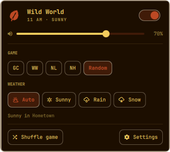
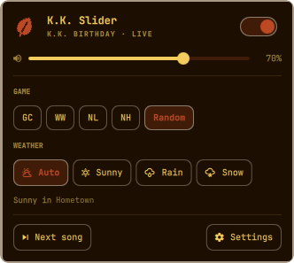
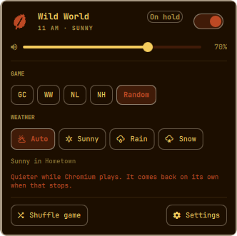
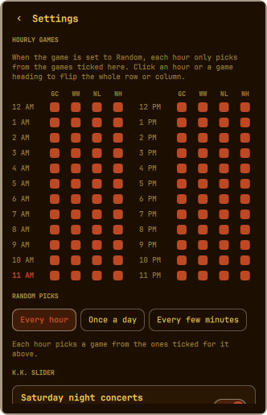
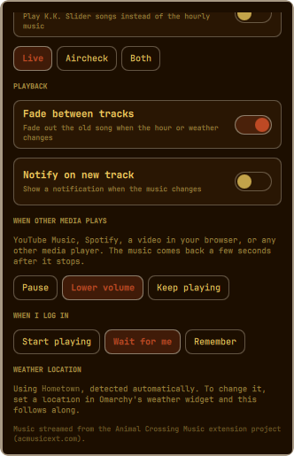

# AC Hourly Music for Omarchy

Animal Crossing's hourly music in your [Omarchy](https://omarchy.org) bar.

A small leaf sits in your bar. Every hour, on the hour, the music changes to
that hour's theme, just like in the games. It can follow your real weather
with the rain and snow versions, mix the four games together, step aside
when you play something else, and hand the stage to K.K. Slider on Saturday
nights.

Nothing is stored on your machine. Tracks stream on demand.


## Contents

- [Features](#features)
- [Install](#install)
- [The bar icon](#the-bar-icon)
- [The panel](#the-panel)
- [Settings](#settings)
  - [Hourly games](#hourly-games)
  - [Random picks](#random-picks)
  - [K.K. Slider](#kk-slider)
  - [Playback](#playback)
  - [When other media plays](#when-other-media-plays)
  - [When I log in](#when-i-log-in)
  - [Weather location](#weather-location)
- [Command line and keybinds](#command-line-and-keybinds)
- [Config file](#config-file)
- [Updating and uninstalling](#updating-and-uninstalling)
- [Troubleshooting](#troubleshooting)
- [Network and privacy](#network-and-privacy)
- [Credits](#credits)

## Features

- **Four games:** Animal Crossing (GameCube), Wild World / City Folk, New Leaf, and New Horizons, or **Random** to mix them.
- **Real weather:** on *Auto*, you hear the rain and snow versions when it's raining or snowing where you are. You can also lock it to Sunny, Rain, or Snow.
- **Per-hour picks:** a 24-hour grid decides which games Random may choose each hour. Don't like New Leaf's 11 AM theme? Untick it and it never plays at 11 AM.
- **Three ways to mix:** a new game every hour, one game all day, or switch every few minutes (10, 15, 30, or any interval you like).
- **K.K. Slider:** Saturday night concerts from 8 PM to midnight, or K.K. all the time. Pick live versions, aircheck versions, or both.
- **Seamless loops:** each song loops at the game's own loop point instead of restarting its intro.
- **Steps aside for other media:** when YouTube Music, Spotify, a video, or any other player starts, the music pauses or turns down. It comes back by itself when that stops.
- **Your choice at login:** start playing, wait for you to press play, or pick up where you left off.
- **Fits Omarchy:** uses Omarchy's own panel styling, follows your theme, and works with any bar position.
- **Scriptable:** a small `ac-music` command for terminals and keybinds.

## Install

```bash
omarchy plugin add https://github.com/NinDaniel/omarchy-ac-music --enable
```

The leaf appears on the right side of your bar and the music starts.

**Requirements:** `mpv` and `curl`. Both come with Omarchy.

**Moving the leaf:** drag it along the bar like any other widget, or run:

```bash
omarchy bar move danr.ac-music --section left    # left | center | right
```

## The bar icon

| On the leaf  | What it does                                                  |
|--------------|---------------------------------------------------------------|
| Hover        | Shows what's playing (and whether it's paused or on hold)     |
| Left click   | Opens the panel                                               |
| Right click  | Play / pause                                                  |
| Middle click | Shuffle to another game (Random) or skip to the next K.K. song |
| Scroll       | Volume up / down in 5% steps                                  |

The leaf is dimmed while the music is paused, on hold, or turned down.

## The panel

<p>
  
  
  
</p>

From top to bottom:

- **Now playing:** the game (or *K.K. Slider*) with the hour and weather underneath, or the song title and version during K.K. The switch on the right plays and pauses. A **Paused** or **On hold** tag shows when the music isn't playing.
- **Volume:** the slider sets the plugin's own volume, separate from your system volume.
- **Game:** **GC** (Animal Crossing on GameCube), **WW** (Wild World / City Folk), **NL** (New Leaf), **NH** (New Horizons), or **Random**. Hover a button for the full name. Picking a specific game always plays that game; the per-hour grid only applies to Random.
- **Weather:** **Auto** follows the real weather. **Sunny**, **Rain**, and **Snow** lock it. On Auto, the line underneath shows the current conditions and where they're from.
- **On hold:** when another player is playing, a line explains that the music is paused (or quieter) and will come back on its own.
- **Shuffle game / Next song:** shows when it's useful. On Random it rolls a different game for now; during K.K. it skips to another song.
- **Settings:** opens the settings view.

**Keyboard**, while the panel is open:

| Key         | Action                                      |
|-------------|---------------------------------------------|
| `p`, Space, or Enter | Play / pause                    |
| `n`         | Shuffle game / next K.K. song               |
| `s`         | Switch between the panel and Settings       |
| `Esc`       | Back out of Settings, or close the panel    |
| `Tab`       | Move to the neighbouring bar panel          |

## Settings

<p>
  
  
</p>

Every change saves immediately; there's no Save button.

### Hourly games

A grid of 24 hours by 4 games. When the game is set to **Random**, each hour
only picks from the games ticked for that hour.

- Click a box to tick or untick one game for one hour.
- Click an **hour** (like `11 AM`) to tick or untick all four games for that hour.
- Click a **game heading** (like `NL`) to tick or untick that game for all twelve hours in that half of the grid (AM or PM).
- The current hour is highlighted.
- An hour with **nothing** ticked behaves as if everything is ticked, so it never goes silent.

The grid has no effect when you've picked a specific game.

### Random picks

How Random chooses a game. The line under the buttons explains the selected option.

| Option                | What you hear |
|-----------------------|---------------|
| **Every hour**        | A new game each hour, chosen from that hour's ticked games. |
| **Once a day**        | One game all day, from midnight to midnight on your computer's clock. If that game is unticked for some hour, that hour picks from its ticked games instead, then the day's game comes back. |
| **Every few minutes** | Switches between the games' versions of the *current hour's* song. Pick **10 min**, **15 min**, **30 min**, or **Custom** (1 to 60 minutes). |

Details worth knowing:

- Picks are **stable**. The game is worked out from the date and hour, so restarting your computer or the shell mid-hour doesn't change what's playing.
- **Every few minutes** lines up with the clock. At 15 minutes it switches at :00, :15, :30, and :45. With a custom interval that doesn't divide the hour, like 7 minutes, the last stretch before the hour is shorter, and the hour change always starts fresh.
- Each hour gets its own shuffled order of games. Every switch lands on a **different** game, and all of the hour's ticked games play before any repeat. If only one game is ticked for an hour, it simply stays on that game.
- **Shuffle game** (or a middle click) rolls a new pick or a new order. That lasts until the next hour.

### K.K. Slider

| Setting                     | What it does |
|-----------------------------|--------------|
| **Saturday night concerts** | K.K. takes over every Saturday from 8 PM until midnight (your local time), like in the games. On by default. |
| **K.K. all the time**       | Plays K.K. songs instead of the hourly music, any day and any time. |
| **Live / Aircheck / Both**  | *Live* is K.K. with his guitar; *Aircheck* is the full-band radio version; *Both* picks either at random for each song. |

During K.K., songs play through once and the next starts automatically. They're
drawn from 92 songs across the series and won't repeat until 20 others have
played. The Game and Weather choices are ignored until K.K. is over.

### Playback

| Setting                 | What it does |
|-------------------------|--------------|
| **Fade between tracks** | Fades the old song out over about a second and a half when the hour, weather, or game changes. Off means an instant switch. |
| **Notify on new track** | Shows a desktop notification with the game and hour (or K.K. song) whenever the music changes. Off by default. |

### When other media plays

Anything that shows up in Omarchy's media controls counts: YouTube or YouTube
Music in a browser, Spotify, a video, VLC, and so on.

| Option           | What happens |
|------------------|--------------|
| **Pause**        | The music pauses as soon as the other player starts (default). |
| **Lower volume** | The music keeps going at a quarter of your volume. |
| **Keep playing** | Nothing changes. |

Once every other player has stopped or paused, the music comes back after about
**3 seconds**. That short wait means the gap between two YouTube songs doesn't
make it jump back in. Apps that don't report to the media controls (most games,
for example) won't trigger it.

### When I log in

| Option            | What happens when you log in |
|-------------------|------------------------------|
| **Start playing** | The music starts every time (default). |
| **Wait for me**   | It stays paused until you press play, then plays for the rest of that session. |
| **Remember**      | It plays if it was playing when you logged out, and stays paused if it wasn't. |

Only a real login counts. Restarting the Omarchy shell or updating the plugin
keeps whatever was already happening.

### Weather location

Auto weather uses the location set in **Omarchy's weather widget**. If you
haven't set one, the plugin works out your location the same way that widget
does (from your IP address). To change it, set a location in the weather widget
and the music follows along; there's nothing to configure here.

The weather is checked when the plugin starts and every 20 minutes after that.
Rain covers drizzle, rain, freezing rain, showers, and thunderstorms. Snow covers
snowfall, snow grains, and snow showers. Everything else, cloudy and foggy
included, counts as sunny.

The original GameCube game has no rain music, so on a rainy day it plays its
sunny version (the panel says so).

## Command line and keybinds

The plugin includes a small `ac-music` command. To put it on your PATH:

```bash
ln -s ~/.config/omarchy/plugins/danr.ac-music/bin/ac-music ~/.local/bin/ac-music
```

| Command                    | What it does |
|----------------------------|--------------|
| `ac-music toggle`          | Play / pause |
| `ac-music play`            | Play |
| `ac-music pause`           | Pause |
| `ac-music next`            | Shuffle game (Random) or next K.K. song |
| `ac-music status`          | Print what's playing, e.g. `Playing: New Leaf - 11 AM · Raining` |
| `ac-music game <game>`     | `animal-crossing`, `wild-world`, `new-leaf`, `new-horizons`, or `random` |
| `ac-music weather <mode>`  | `auto`, `sunny`, `rain`, or `snow` |
| `ac-music volume <n>`      | Set the volume (`50`) or nudge it (`+5`, `-10`) |
| `ac-music kk [on\|off]`    | K.K. all the time; toggles with no argument |
| `ac-music panel`           | Open or close the panel |
| `ac-music settings`        | Open the panel on Settings |

Without the symlink, every command also works as
`omarchy-shell danr.ac-music <command> [arg]` (for example
`omarchy-shell danr.ac-music toggle`).

Example keybinds for `~/.config/hypr/bindings.lua`:

```lua
o.bind("SUPER + CTRL + M", "AC music play/pause", "ac-music toggle")
o.bind("SUPER + CTRL + N", "AC music next", "ac-music next")
```

## Config file

Settings live in `~/.config/omarchy/ac-music.json`. The panel writes it for
you, but you can edit it by hand too; changes apply as soon as you save.
Anything missing or invalid falls back to its default.

| Key              | Values | Default |
|------------------|--------|---------|
| `playing`        | `true` / `false` | `true` |
| `volume`         | `0` to `1` | `0.5` |
| `game`           | `animal-crossing`, `wild-world`, `new-leaf`, `new-horizons`, `random` | `new-horizons` |
| `weather`        | `auto`, `sunny`, `raining`, `snowing` | `auto` |
| `randomMode`     | `hourly`, `daily`, `interval` | `hourly` |
| `shuffleMinutes` | `1` to `60` (used by `interval`) | `15` |
| `hours`          | `"0"` to `"23"`, each a list of allowed games | every game, every hour |
| `kk.saturday`    | `true` / `false` | `true` |
| `kk.always`      | `true` / `false` | `false` |
| `kk.version`     | `live`, `aircheck`, `both` | `live` |
| `fade`           | `true` / `false` | `true` |
| `notify`         | `true` / `false` | `false` |
| `otherMedia`     | `pause`, `lower`, `ignore` | `pause` |
| `atLogin`        | `play`, `wait`, `resume` | `play` |

For example, to keep New Leaf out of 11 AM:

```json
"hours": {
  "11": ["animal-crossing", "wild-world", "new-horizons"]
}
```

## Updating and uninstalling

Update:

```bash
omarchy plugin update danr.ac-music
omarchy restart shell
```

The restart matters. The part of the plugin that plays the music stays loaded
in the background and only picks up new code when the shell restarts.

Uninstall:

```bash
omarchy plugin remove danr.ac-music
rm ~/.config/omarchy/ac-music.json    # optional: your settings
```

## Troubleshooting

**No sound.** Run `ac-music status` (or `omarchy-shell danr.ac-music status`).
If it says *Playing*, check that the volume slider isn't at 0%, and look for
**AC Music** in your audio mixer; it appears there as its own app with its own
volume. If it says *On hold*, another player is playing. Pause it, or switch
**When other media plays** to *Keep playing*.

**"Couldn't reach the music server."** You're offline, or the music server is
down. The plugin tries again every 30 seconds by itself.

**The weather looks wrong.** Check the location shown under Settings →
Weather location. Set the right one in Omarchy's weather widget.

**Changes after an update don't show up.** Run `omarchy restart shell`.

**The leaf is missing from the bar.** Run `omarchy plugin enable danr.ac-music --section right`.

## Network and privacy

The plugin talks to three services:

- **acmusicext.com:** the music itself. One song (usually 3 to 7 MB) per track
  change: once an hour normally, at every switch in *Every few minutes* mode,
  and once per song during K.K. Loops replay from memory and don't download again.
- **api.open-meteo.com:** current weather for your coordinates, every 20 minutes,
  only while Weather is on *Auto*.
- **wttr.in:** only when Omarchy's weather widget has no location set, to work
  out roughly where you are (the same thing the weather widget does).

There's no account, no analytics, and nothing is sent anywhere else.

## Credits

The music is streamed from the server run by the
[Animal Crossing Music extension](https://github.com/animal-crossing-music-extension/ac-music-extension),
the browser extension that inspired this plugin. The loop points and the K.K.
song list also come from that project (zlib license). This plugin uses
[Open-Meteo](https://open-meteo.com) for weather instead of the extension's own
weather service to keep the load on their server down. If their server goes
away, this plugin stops working.

Animal Crossing is a trademark of Nintendo. This is an unofficial fan project
and is not affiliated with or endorsed by Nintendo.

## License

MIT; see [LICENSE](LICENSE).
